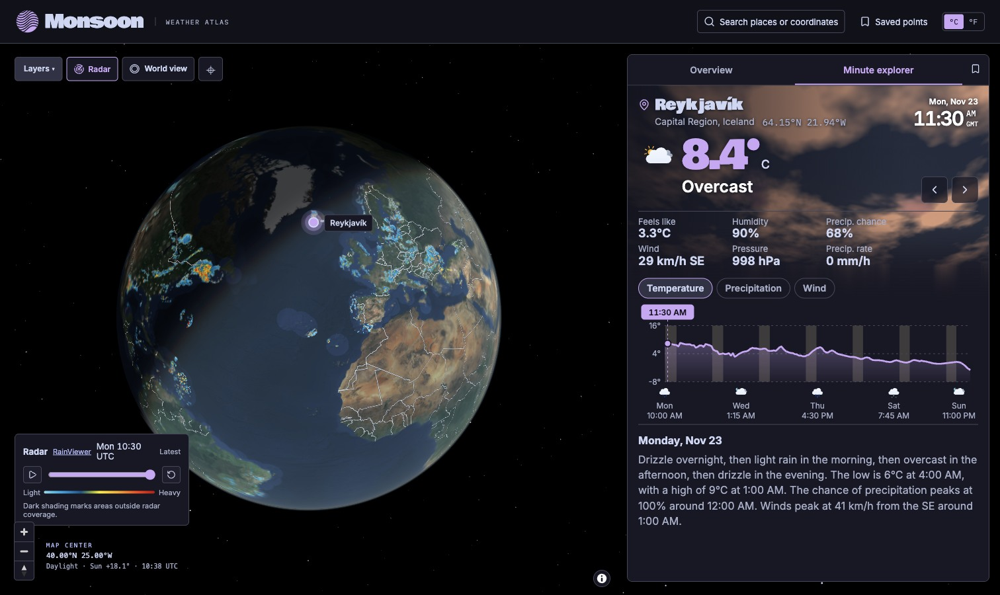

# Monsoon · Weather Atlas

Spin the Earth, pick a point, and watch the next storm roll through. Monsoon pairs a sunlit satellite globe with a forecast you can scrub minute by minute. It runs as an Electron desktop app or in a browser. No API keys to configure.



## Take it for a spin

- **Find the edge of night.** The globe calculates the Sun’s position from the current date and time. Follow the twilight line across the ocean, then zoom into the dark side. The imagery brightens as you approach the surface.
- **Drop into a forecast.** Click the globe, search for a town, or paste decimal coordinates. The overview opens with current conditions and a local clock, followed by seven days of day and night forecasts. On a phone, tap the location bubble to open the sheet.
- **Scrub through the week.** Open **Minute explorer** and hover, drag, or scroll. The clock, readings, and illustrated sky follow the selected minute. Yellow bands mark daylight on the chart. Watch the temperature cross freezing or switch to precipitation and wind to see when a front arrives. Minute readings are interpolated from Open-Meteo’s hourly forecasts.
- **Play back the radar.** Use **Radar** to step through the past two hours of observed precipitation where coverage is available. Each frame has a UTC timestamp. Use **Layers** to adjust imagery, roads, and place labels.

With the forecast graph focused, **← / →** move one minute and **Page Up / Page Down** move one hour. Bookmarks and unit preferences stay on your device.

## Run locally

With Node.js 22.18 or newer and npm installed, clone the repository and launch the desktop app.

```sh
git clone https://github.com/binarydoubling/monsoon.git
cd monsoon
npm ci
npm start
```

| Command                | What it does                                                                     |
| ---------------------- | -------------------------------------------------------------------------------- |
| `npm run web`          | Starts the Vite development server with live updates.                            |
| `npm run build`        | Packages the Electron app for your current OS and architecture under `release/`. |
| `npm run typecheck`    | Checks TypeScript across the renderer, desktop app, and build scripts.           |
| `npm run format:check` | Checks Prettier formatting and runs ESLint.                                      |
| `npm run format`       | Applies formatting and ESLint fixes.                                             |

On Apple Silicon, the local build produces `release/Monsoon-darwin-arm64/Monsoon.app`. macOS builds are ad hoc signed.

## Inside the atlas

React and TypeScript drive the interface. MapLibre GL JS renders the globe, and Three.js draws the forecast sky, including clouds, rain, snow, fog, and lightning. The stars come from catalogue positions and magnitudes. The globe follows the real clock while the forecast sky follows the time you select. [MapLibre GL JS](https://maplibre.org/maplibre-gl-js/docs/) · [US Naval Observatory solar calculations](https://aa.usno.navy.mil/faq/sun_approx) · [ESA Hipparcos Catalogue via CDS VizieR](https://cdsarc.cds.unistra.fr/viz-bin/cat/I/239)

### Data and artwork credits

| Layer                        | Sources and coverage                                                                                                                                                                                                                                                                                                                                                                                                                                                                                             |
| ---------------------------- | ---------------------------------------------------------------------------------------------------------------------------------------------------------------------------------------------------------------------------------------------------------------------------------------------------------------------------------------------------------------------------------------------------------------------------------------------------------------------------------------------------------------- |
| Forecasts                    | Current, hourly, and daily weather from Open-Meteo. Forecast data is CC BY 4.0. The free endpoint is for non-commercial use, subject to rate limits. [Open-Meteo](https://open-meteo.com/) · [Service terms](https://open-meteo.com/en/terms)                                                                                                                                                                                                                                                                    |
| Radar                        | Observed composites from RainViewer’s participating radar stations. Its keyless feed supports personal and educational use, with native tiles through zoom 7. [RainViewer Weather Maps API](https://www.rainviewer.com/api/weather-maps-api.html)                                                                                                                                                                                                                                                                |
| Satellite and aerial imagery | EOxCloudless by EOX IT Services GmbH contains modified Copernicus Sentinel data from 2025. The opening globe uses bundled tiles from that mosaic and streams finer imagery as you zoom. Close views add aerial photography in the contiguous US where available. [Mosaic license · CC BY-NC-SA 4.0](https://creativecommons.org/licenses/by-nc-sa/4.0/) · [USDA NAIP via USGS](https://imagery.nationalmap.gov/arcgis/rest/services/USGSNAIPImagery/ImageServer)                                                 |
| Borders, streets, and names  | OpenFreeMap serves OpenMapTiles cartography from OpenStreetMap. Natural Earth supplies world-scale labels and city population estimates. Place search uses Open-Meteo geocoding and GeoNames. Photon resolves nearby names for map picks while the forecast stays at the selected coordinates. [OpenFreeMap](https://openfreemap.org/) · [OpenStreetMap contributors](https://www.openstreetmap.org/copyright) · [Natural Earth](https://www.naturalearthdata.com/) · [Photon](https://github.com/komoot/photon) |
| Relief maps                  | The bundled world map uses Natural Earth land outlines and Mapzen Terrain Tiles. [Terrain credits](assets/maps/ATTRIBUTION.txt)                                                                                                                                                                                                                                                                                                                                                                                  |
| Weather icons                | Bas Milius’s Meteocons supply the animated weather symbols and their reduced-motion counterparts. [Meteocons](https://github.com/basmilius/meteocons) · [MIT license](public/meteocons/LICENSE)                                                                                                                                                                                                                                                                                                                  |

The atlas starts in Reykjavík on first launch. Selecting a point saves it on this device, and the next launch opens the globe and forecast there. The bundled satellite overview is available offline. Fresh forecasts, radar, and higher-resolution imagery use the network. Successful forecast requests are cached in memory for 15 minutes.
